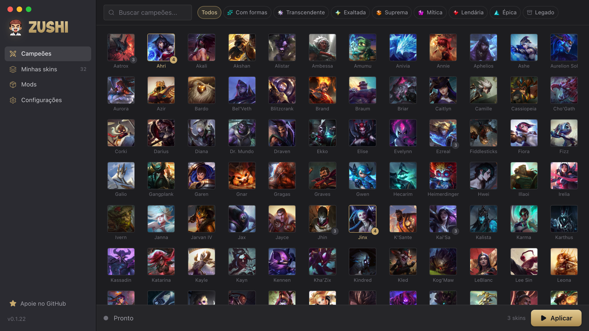
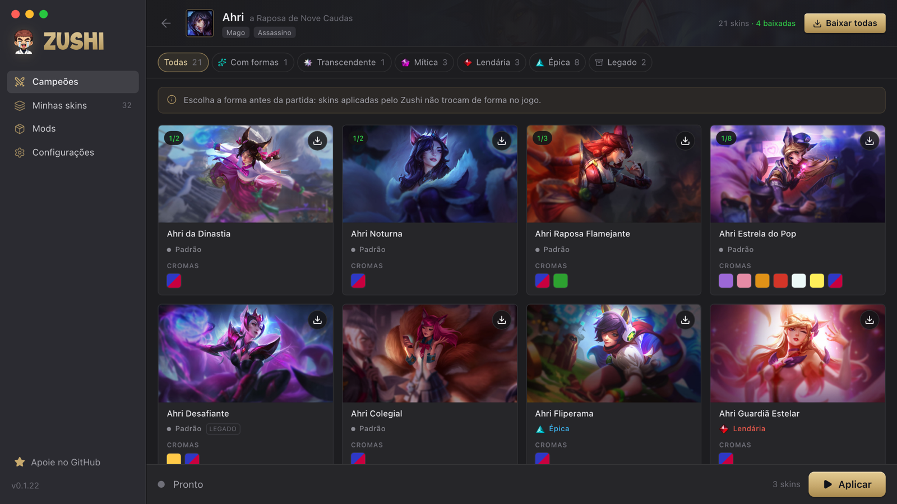
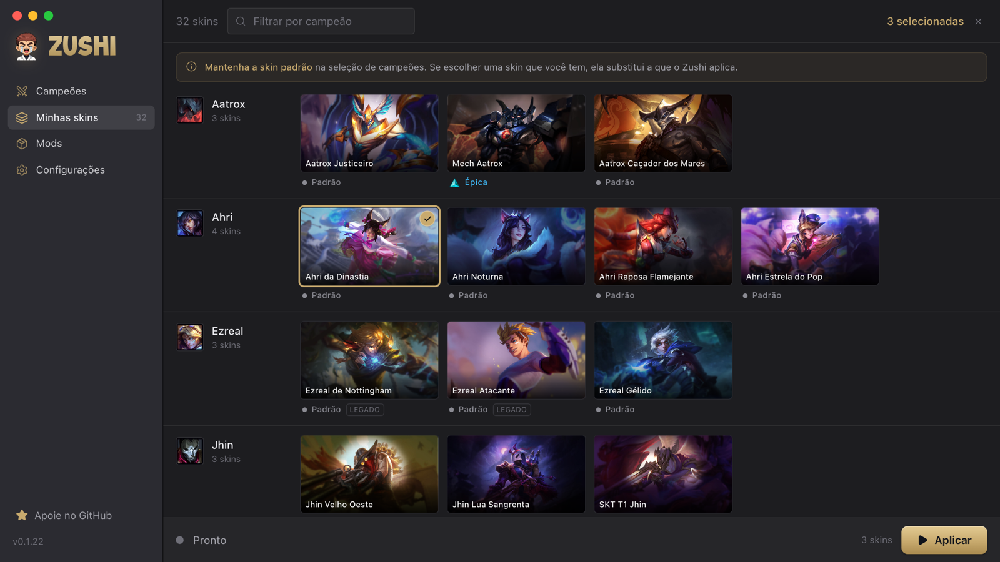
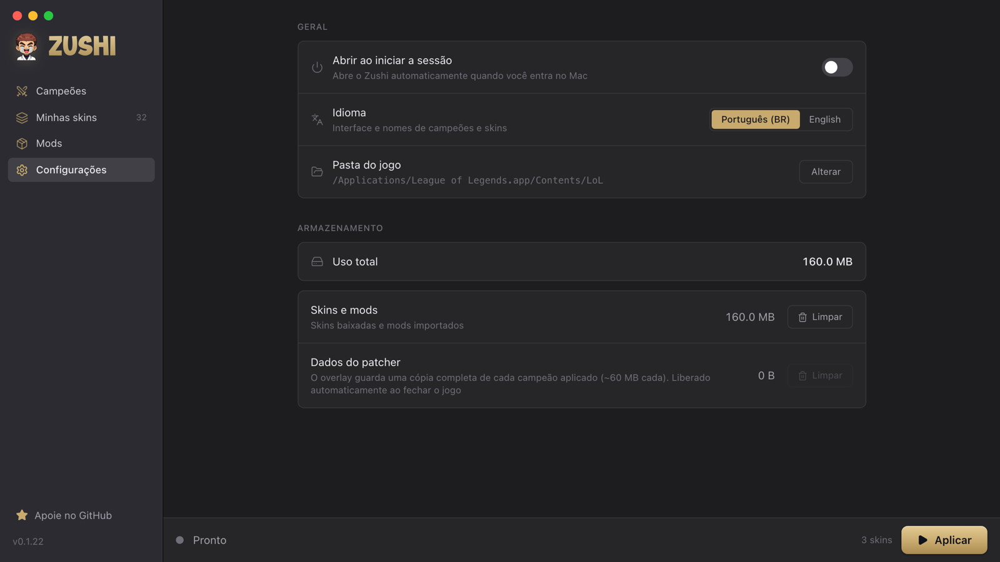

<p align="center">
  
</p>

<h1 align="center">Zushi</h1>

<p align="center">
  <a href="https://github.com/baku01/zushi/releases/latest"></a>
</p>

<p align="center">
  
  
  
  
  
</p>

<p align="center">
  A lightweight macOS app to browse, download and apply League of Legends skins.
</p>

<p align="center">
  <a href="README.md">🇧🇷 Português</a> · 🇺🇸 English
</p>

---

<p align="center">
  
</p>

## Features

- **Full catalog** of champions and skins, with splash art and names in English or Portuguese
- **Downloads**: one skin, a skin with all its variants, or every skin of a champion
- **Chromas and forms** grouped under their base skin, with a form preview on hover
- **Rarity and type filters**: Forms, Transcendent, Exalted, Ultimate, Mythic, Legendary, Epic and Legacy
- **Batch apply**: pick one skin per champion and apply them all at once
- **Skin updates**: tells you when a skin was republished upstream (for example a sound fix) and updates everything in one click
- **Custom mods** (`.fantome`, `.zip`, `.modpkg`) with per-mod toggles
- **Live patcher status**: importing, building the overlay, waiting for the game, skins active...
- **Game auto-detection**: finds your League installation
- **Storage management**: see what takes space and clear it in one click
- **Native macOS look**: translucent sidebar, Apple Silicon and Intel
- **Self-updating**: the app tells you when a new version is out

## Screenshots

<table>
  <tr>
    <td width="50%"></td>
    <td width="50%"></td>
  </tr>
  <tr>
    <td align="center"><sub><b>Champion</b>: skins, chromas, forms, rarity and filters</sub></td>
    <td align="center"><sub><b>My Skins</b>: pick one per champion and apply</sub></td>
  </tr>
  <tr>
    <td colspan="2" align="center"></td>
  </tr>
  <tr>
    <td colspan="2" align="center"><sub><b>Settings</b>: language, game folder, launch at login and storage</sub></td>
  </tr>
</table>

## Installation

1. Download the latest `.dmg` for your Mac from the [Releases page](https://github.com/baku01/zushi/releases/latest):
   - **Apple Silicon** (M1/M2/M3/M4/M5...): `Zushi_x.x.x_aarch64.dmg`
   - **Intel**: `Zushi_x.x.x_x64.dmg`
2. Open the `.dmg` and drag Zushi to your Applications folder.
3. On first launch, macOS may show **"Zushi is damaged and can't be opened"**. This is normal for ad-hoc signed apps. To fix it, run in Terminal:
   ```
   xattr -cr /Applications/Zushi.app
   ```
   Then open the app again normally.

After that, Zushi updates itself: when a new version is out, click **Update & restart** in the sidebar. No new download or `xattr` needed.

> **Administrator password:** Zushi asks for your Mac password on launch. The patcher needs administrator privileges to modify the game process on macOS. The app uses that access for nothing else.

## Usage

1. **Start the League client** and leave it running.
2. **Run Zushi** once the client is up.
3. **Download skins**: pick a champion and download the skins you want.
4. **Select and apply**: in **My Skins**, pick **one skin per champion** and click **Apply**.
5. **Start your game**: with the patcher showing **Waiting for game**, queue up and play.

> **Important:** apply the skin before champion select ends, keeping the default skin selected in the client, so it is locked in when the game starts. If it does not apply, close the game, reopen League, run Zushi again, apply, and reconnect.

### Tips

- **Forms** (skins that transform during a match) can't be switched in game: pick the form in **My Skins** before playing.
- **Deleting a skin**: hover the card and click the **×**. For a skin with variants the button asks for a second click. You can also right-click a chroma or form to delete it.
- **Updating skins**: when skins were republished, an **Update N skins** button appears at the top of My Skins.

## Storage

| What | Where | Size |
| --- | --- | --- |
| Downloaded skins | `~/Library/Application Support/com.zushi.app/skins` | hundreds of KB to a few MB per skin |
| Custom mods | `~/Library/Application Support/com.zushi.app/customs` | the imported file's size |
| Patcher data (overlay) | `~/Library/Application Support/com.zushi.app/overlay` | **~60 MB per applied champion** |

The overlay holds a complete copy of the champion's game file (WAD) with the skin merged in, which is why it is large. Zushi **deletes the overlay automatically** when League closes, or if the patcher ends without ever finding the game. It is only kept while the game may still be reading from it, for example if you stop the patcher by hand mid-match. You can also clear everything in **Settings → Storage**.

## Troubleshooting

| Problem | What to do |
| --- | --- |
| "Zushi is damaged" | Run `xattr -cr /Applications/Zushi.app` in Terminal |
| The skin doesn't show in game | Apply **before** champion select ends and keep the default skin in the client. If it still fails, close the game, reopen League, apply again and reconnect |
| "You can't apply two skins to the same champion" | Keep only one skin selected per champion |
| Zushi can't find the game | In **Settings → Game folder**, pick the League folder manually |
| I can't delete or clear | Stop the patcher first: those actions are blocked while it is active |

## Development

Requirements: Node.js 22+, Rust (stable) and the Xcode command line tools.

```bash
npm install
npm run tauri dev        # full app (asks for the administrator password)
npm run dev              # UI only, in the browser
npm run build            # tsc + vite build
cd src-tauri && cargo test
```

The patcher is `mod-tools` (C++/CMake), in `mod-tools/`, bundled as a sidecar in `src-tauri/binaries/`.

## Releasing

Every push and pull request runs CI (`.github/workflows/ci.yaml`: frontend build, mod-tools for both architectures, `cargo test`).

To publish a version, bump it and push to `main`:

```
node scripts/bump-version.mjs patch   # or minor, major, or an explicit x.y.z
git commit -am "chore: release v0.1.19" && git push
```

`.github/workflows/release.yaml` builds both architectures, signs the updater bundles and publishes `v<version>` with a `latest.json`, which installed apps pick up through **Update & restart**. Pushes that keep the same version don't release anything.

The workflow needs the `TAURI_SIGNING_PRIVATE_KEY` and `TAURI_SIGNING_PRIVATE_KEY_PASSWORD` secrets, matching `plugins.updater.pubkey` in `src-tauri/tauri.conf.json`. Losing that key means installed apps can no longer verify updates.

## Disclaimer

Zushi is not endorsed by Riot Games and does not reflect the views or opinions of Riot Games or anyone officially involved in producing or managing Riot Games properties. Riot Games and all associated properties are trademarks or registered trademarks of Riot Games, Inc.

Skins are visible only to you and do not affect gameplay or provide any competitive advantage. Use at your own risk.

## License

This project is licensed under the MIT License.
