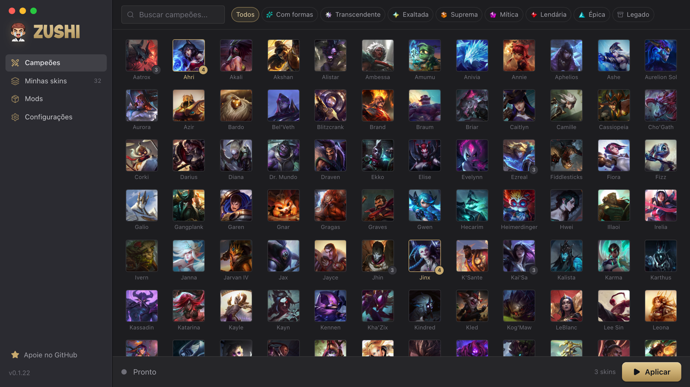
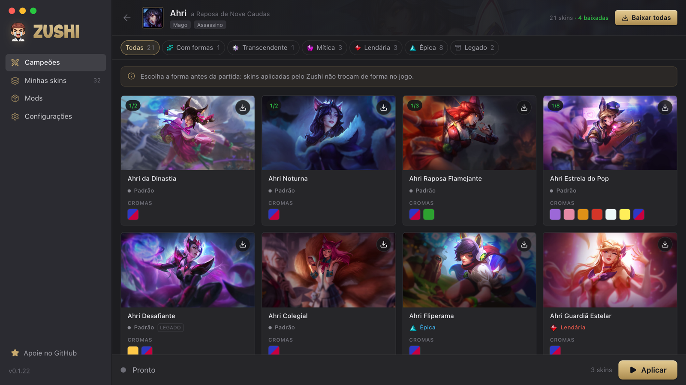
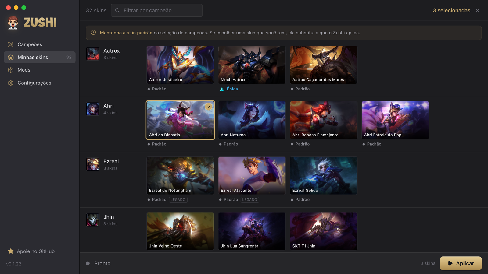
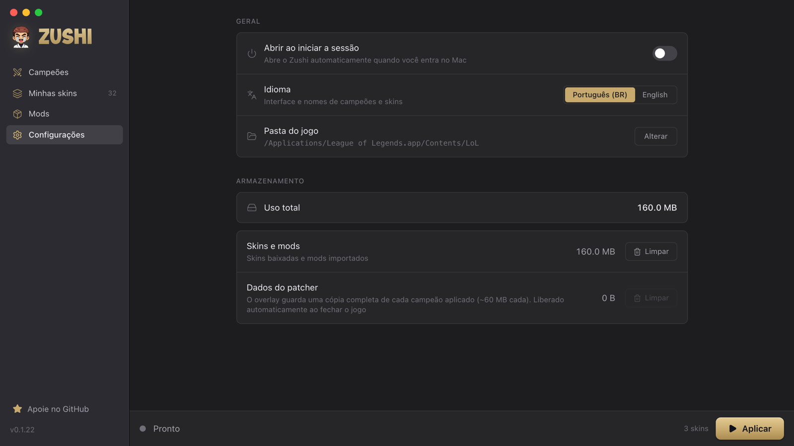

<p align="center">
  
</p>

<h1 align="center">Zushi</h1>

<p align="center">
  <a href="https://github.com/baku01/zushi/releases/latest"></a>
</p>

<p align="center">
  
  
  
  
  
</p>

<p align="center">
  Um app leve para macOS que navega, baixa e aplica skins de League of Legends.
</p>

<p align="center">
  🇧🇷 Português · <a href="README.en.md">🇺🇸 English</a>
</p>

---

<p align="center">
  
</p>

## Funcionalidades

- **Catálogo completo** de campeões e skins, com splash arts e nomes em português ou inglês
- **Download** de uma skin, de uma skin com todas as suas variações ou de todas as skins de um campeão
- **Cromas e formas** agrupados sob a skin base, com prévia da forma ao passar o mouse
- **Raridade e filtros por tipo**: Com formas, Transcendente, Exaltada, Suprema, Mítica, Lendária, Épica e Legado
- **Aplicação em lote**: selecione uma skin por campeão e aplique todas de uma vez
- **Atualizações de skins**: avisa quando uma skin foi republicada no repositório (por exemplo, correção de sons) e atualiza tudo com um clique
- **Mods personalizados** (`.fantome`, `.zip`, `.modpkg`) com ativação individual
- **Status do patcher em tempo real**: importando, montando o overlay, aguardando o jogo, skins ativas…
- **Detecção automática** da instalação do League
- **Gerenciamento de armazenamento**: veja quanto espaço cada coisa ocupa e limpe com um clique
- **Visual nativo do macOS**: barra lateral translúcida, Apple Silicon e Intel
- **Atualização automática**: o próprio app avisa quando há versão nova

## Telas

<table>
  <tr>
    <td width="50%"></td>
    <td width="50%"></td>
  </tr>
  <tr>
    <td align="center"><sub><b>Campeão</b>: skins, cromas, formas, raridade e filtros</sub></td>
    <td align="center"><sub><b>Minhas skins</b>: escolha uma por campeão e aplique</sub></td>
  </tr>
  <tr>
    <td colspan="2" align="center"></td>
  </tr>
  <tr>
    <td colspan="2" align="center"><sub><b>Configurações</b>: idioma, pasta do jogo, abrir ao iniciar e armazenamento</sub></td>
  </tr>
</table>

## Instalação

1. Baixe o `.dmg` para o seu Mac na [página de Releases](https://github.com/baku01/zushi/releases/latest):
   - **Apple Silicon** (M1/M2/M3/M4/M5...): `Zushi_x.x.x_aarch64.dmg`
   - **Intel**: `Zushi_x.x.x_x64.dmg`
2. Abra o `.dmg` e arraste o Zushi para a pasta Aplicativos.
3. Na primeira abertura, o macOS pode mostrar **"O Zushi está danificado e não pode ser aberto"**. Isso é normal em apps com assinatura ad-hoc. Para resolver, rode no Terminal:
   ```
   xattr -cr /Applications/Zushi.app
   ```
   Depois abra o app normalmente.

Depois disso o Zushi se atualiza sozinho: quando sair uma versão nova, clique em **Atualizar e reiniciar** na barra lateral. Não precisa baixar nada de novo nem repetir o `xattr`.

> **Senha de administrador:** o Zushi pede a senha do Mac ao abrir. O patcher precisa de privilégios de administrador para modificar o processo do jogo no macOS. O app não faz nada além disso com esse acesso.

## Como usar

1. **Abra o cliente do League** e deixe-o aberto.
2. **Abra o Zushi** depois que o cliente estiver pronto.
3. **Baixe as skins**: escolha um campeão e baixe as skins que quiser.
4. **Selecione e aplique**: em **Minhas skins**, escolha **uma skin por campeão** e clique em **Aplicar**.
5. **Inicie a partida**: com o patcher em **Aguardando o jogo**, entre na fila e jogue.

> **Importante:** aplique a skin antes do fim da seleção de campeões, mantendo a skin padrão selecionada no cliente, para que ela seja carregada quando a partida começar. Se não funcionar, feche o jogo, abra o League de novo, rode o Zushi, aplique e reconecte.

### Dicas

- **Formas** (skins que se transformam durante a partida) não podem ser trocadas no jogo: escolha a forma em **Minhas skins** antes de jogar.
- **Excluir uma skin**: passe o mouse sobre o card e clique no **×**. Para uma skin com variações, o botão pede uma segunda confirmação. Também dá para excluir uma croma ou forma com o botão direito.
- **Atualizar skins**: quando houver skins republicadas, aparece o botão **Atualizar N skins** no topo de Minhas skins.

## Armazenamento

| O que | Onde fica | Tamanho |
| --- | --- | --- |
| Skins baixadas | `~/Library/Application Support/com.zushi.app/skins` | de centenas de KB a poucos MB por skin |
| Mods personalizados | `~/Library/Application Support/com.zushi.app/customs` | o tamanho do arquivo importado |
| Dados do patcher (overlay) | `~/Library/Application Support/com.zushi.app/overlay` | **~60 MB por campeão aplicado** |

O overlay contém uma cópia completa do arquivo do campeão (WAD) com a skin embutida, por isso ele é grande. O Zushi **apaga o overlay automaticamente** quando o League fecha, ou se o patcher terminar sem ter encontrado o jogo. Ele só é mantido enquanto o jogo ainda pode estar lendo dele, por exemplo se você parar o patcher à mão durante a partida. Você também pode limpar tudo em **Configurações → Armazenamento**.

## Problemas comuns

| Problema | O que fazer |
| --- | --- |
| "O Zushi está danificado" | Rode `xattr -cr /Applications/Zushi.app` no Terminal |
| A skin não aparece na partida | Aplique **antes** do fim da seleção de campeões e mantenha a skin padrão no cliente. Se continuar, feche o jogo, reabra o League, aplique de novo e reconecte |
| "Você não pode aplicar duas skins ao mesmo campeão" | Deixe apenas uma skin selecionada por campeão |
| O Zushi não acha o jogo | Em **Configurações → Pasta do jogo**, escolha a pasta do League manualmente |
| Não consigo excluir ou limpar | Pare o patcher primeiro: com ele ativo, essas ações ficam bloqueadas |

## Desenvolvimento

Pré-requisitos: Node.js 22+, Rust (stable) e as ferramentas de linha de comando do Xcode.

```bash
npm install
npm run tauri dev        # app completo (pede a senha de administrador)
npm run dev              # só a interface, no navegador
npm run build            # tsc + vite build
cd src-tauri && cargo test
```

O patcher é o `mod-tools` (C++/CMake), que fica em `mod-tools/` e é embutido como sidecar em `src-tauri/binaries/`.

## Lançando versões

Todo push e pull request roda a CI (`.github/workflows/ci.yaml`): build do frontend, `mod-tools` para as duas arquiteturas e `cargo test`.

Para publicar uma versão, aumente o número e faça push na `main`:

```
node scripts/bump-version.mjs patch   # ou minor, major, ou um x.y.z explícito
git commit -am "chore: release v0.1.19" && git push
```

O `.github/workflows/release.yaml` compila as duas arquiteturas, assina os pacotes de atualização e publica `v<versão>` junto com um `latest.json`, que os apps instalados usam em **Atualizar e reiniciar**. Pushes que mantêm a mesma versão não publicam nada.

O workflow precisa dos secrets `TAURI_SIGNING_PRIVATE_KEY` e `TAURI_SIGNING_PRIVATE_KEY_PASSWORD`, que correspondem a `plugins.updater.pubkey` em `src-tauri/tauri.conf.json`. Perder essa chave significa que os apps instalados não conseguem mais verificar atualizações.

## Aviso legal

O Zushi não é endossado pela Riot Games e não reflete as opiniões de ninguém oficialmente envolvido na produção ou no gerenciamento das propriedades da Riot Games. Riot Games e todas as propriedades associadas são marcas comerciais ou marcas registradas da Riot Games, Inc.

As skins são visíveis apenas para você e não afetam a jogabilidade nem dão qualquer vantagem competitiva. Use por sua conta e risco.

## Licença

Este projeto está licenciado sob a Licença MIT.
